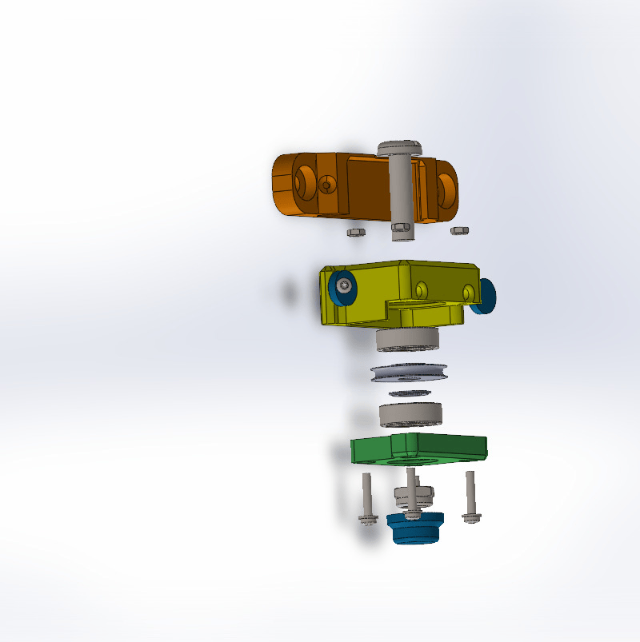

# Lightio Curtains Controller

A DIY controller for motorized curtains and dimmable lighting, created under the **Lightio art lighting** brand.

The controller uses an ESP32-S3, a stepper motor, magnetic position feedback, and end switches to open, close, or move curtains to a chosen position. You can control it through a browser, MQTT, Home Assistant, an NEC-compatible infrared remote, or a daily schedule. A physical setup switch lets you enable the configuration access point without a remote.

Main features:

- Curtain positioning: **0% = fully open; 100% = fully closed** in the WebUI and direct MQTT commands. Home Assistant translates this to its own position convention.
- Adjustable motor speed, homing, travel calibration, and motor error reporting.
- Lighting on/off and brightness control.
- Daily scheduled actions for curtains and lighting.
- Local WebUI with settings, schedules, logs, and firmware updates.
- MQTT commands, status reporting, and Home Assistant discovery.
- Device diagnostics, including uptime, WiFi signal, memory usage, and filesystem space.

**This project requires advanced assembly and soldering skills.** All materials are provided “as is,” without any guarantee of functionality.

See the [firmware user guide](firmware/instructions.md) for wiring, flashing, configuration, MQTT topics, and troubleshooting. The [controller assembly guide](3d-models/Controller/Assembly_Guide.pdf) covers mechanical assembly.

## Video demo

- [Controller demo ](https://youtu.be/Y9OxHzuBrEo)
- [Controller demo (YouTube Short)](https://www.youtube.com/shorts/wfgeleJTWx8)
- [Controller demo 2](https://youtu.be/F_Q0FNfF7aQ)

## Project pages

- [GitHub repository](https://github.com/mrmanfreee/BlindShutter)
- MakerWorld: project page planned.
- Printables: project page planned.

## Support the project

If you find this project useful, you can help fund its continued development. Contributions help cover components, prototypes, and testing as hardware and EU import costs rise. Any support helps make future improvements possible.

- [Support on Ko-fi](https://ko-fi.com/mrmanfree)
- [GitHub Sponsors](https://github.com/sponsors/mrmanfreee)

## Hardware and materials

### Controller

The firmware is currently built for **ESP32-S3 N8R2** and **ESP32-S3 N16R8** controllers. It can also be built for other compatible controllers with **at least 8 MB of flash for OTA updates** and **at least 1 MB of RAM**. Other controllers require a suitable firmware build, memory layout, and GPIO configuration. See the [memory requirements](firmware/instructions.md#current-controller-options-and-memory-requirements) before choosing an image.

You will need:

1. Printed parts from [3d-models/Controller](3d-models/Controller). White PETG is recommended. Depending on which side of the room the controller will be installed on, you may need to mirror the `electronicBox` and `electronicBoxCover` parts before printing.
2. A NEMA 17 stepper motor with a body length of **34–38 mm**.
3. An ESP32-S3 board matching one of the current firmware variants. Solder the pin headers on the opposite side of the board, as shown below, to fit the enclosure.
4. Two end switches, as shown below.
5. An **AS5600 magnetic encoder module** and a suitable shaft magnet.
6. A power connector with an **8 mm mounting diameter**.
7. A **12 V to 5 V step-down converter** and a suitable power supply for the motor and controller.
8. A stepper driver, preferably **TMC2208 or TMC2209**, and a compatible carrier PCB.
9. Springs from ballpoint pens.
10. M3 screws and nuts; see the [assembly guide](3d-models/Controller/Assembly_Guide.pdf) for sizes and quantities.
11. A **VS1838B infrared receiver** for remote control and automatic travel calibration.
12. Optional **3 mm red and blue LEDs** for status indication.
13. An optional **IRLU024N MOSFET** and the required supporting components for LED strip control.
14. An optional LED strip.

The infrared receiver and remote are optional for normal WebUI/MQTT operation, but are required to start automatic full-travel calibration in the current firmware. Without a remote, you can enter a known travel distance manually.

### Pulley block

You will need:

1. Printed parts from [3d-models/PulleyBlock](3d-models/PulleyBlock). White PETG is recommended.
2. **Two 608 bearings**.
3. An **8 mm shoulder bolt or M8 × 30 bolt** for the pulley axle.
4. An **M8 DIN 985 locknut**.
5. **Four M3 nuts**.
6. **Four M3 × 16 screws**.

### Infrared remote (optional)

You will need:

1. Printed parts from [3d-models/Remote](3d-models/Remote).
2. A **CR2032 battery**.
3. **Four 6 × 6 × 5 mm push buttons**.
4. A remote control IC that transmits using the **NEC protocol**. The prototype uses an IC taken from an inexpensive, unbranded RGB LED strip remote. An SC6122 is another potential option, but compatibility has not been confirmed here.

### Additional parts and curtain loop

- Printed parts from [3d-models/AdditionalDetails](3d-models/AdditionalDetails).
- **Two M3 × 8 screws**.
- Plastic ball chain. The mechanism was tested with **4.2 mm balls at an 8 mm pitch** (center-to-center spacing).
- Nylon cord with a diameter of **2–3.5 mm**.

The pulley block is designed for a loop made partly from ball chain and partly from nylon cord. The cord reduces noise where the loop passes the curtain edges, since moving chain balls can catch against the fabric.

## Installation

### Prepare the controller

1. Assemble the controller using the [assembly guide](3d-models/Controller/Assembly_Guide.pdf). Check that both end switches operate correctly. If necessary, gently adjust their metal levers.
2. Flash the firmware and configure WiFi and any WebUI credentials using the [firmware user guide](firmware/instructions.md#3-flashing-the-firmware). 

Short reference: To turn Access Point mode - press and hold open/close button on remote and reset controller, or use configuration pin. When controller in Access point mode all LEDs will be blinking.
Disconnect power before continuing assembly or changing wiring.

3. Set the stepper driver's microstepping and motor current. I set almost maximum current. Keep in mind that excessive current can cause the driver to overheat or shut down.

### Mount the controller and pulley block

1. Mark the controller position on the wall so that the curtain track lies between the two runs of the loop.
2. Attach the mount using two suitable screws or wall plugs. Secure the controller to the mount with a small **1.5 × 5 mm screw**.

   

3. Mount the pulley block at the other end of the curtain track in the same way.
4. Measure and cut the ball chain and nylon cord to suit the installation.

### Fit the chain, cord, and curtains

1. Power on the controller and send an Open, Close, or position command. If the controller has not been homed, it begins moving slowly towards the open end switch.
2. Feed the end of the ball chain into the inlet so that the mechanism draws it through and out of the other side. Keep fingers clear of the drive and avoid pressing the end switches during this step. Stop movement or disconnect power once the chain is threaded.

   

3. Join the chain and nylon cord using the printed connectors to form the loop. Tension the cord and tighten the connector screws.
4. Attach the leading edge of the curtain to a connector. For a second curtain panel, you may need an additional printed `presser` part.
5. With power disconnected, move the curtain to the open position. Fit the `presser` approximately **1 cm from the OPEN end switch**, leaving enough travel for it to reach and activate the switch.

   

6. Move the curtain to the closed position and adjust the corresponding `presser` approximately **1 cm from the CLOSED end switch**, again leaving enough travel to activate it.

   

### Home and calibrate the curtains

1. Power on the controller.
2. Hold **OPEN** on the configured infrared remote for about **two seconds or more**, then release it. Wait for the curtain to reach the open end switch and complete homing.
3. After homing, hold **CLOSE** for about **two seconds or more**, then release it. The controller measures travel to the closed end switch, saves the maximum distance with a small clearance, and returns towards open.
4. Reload **Configuration → Settings** in the WebUI and check **Max travel (mm)**. Test intermediate positions and full closure at a moderate speed.

The home reference is re-established after each restart. A normal movement command can trigger homing automatically when needed; let it finish before sending the desired target again. Repeat homing if the position reference is lost, and repeat travel calibration after moving a `presser` or changing the mechanism.

The current WebUI does not provide dedicated Home or automatic travel-calibration buttons. Without a remote, enter a known distance under **Configuration → Settings → General → Max travel (mm)**, save, restart, and let a normal movement command initiate homing. See the [homing and calibration instructions](firmware/instructions.md#10-ir-remote-homing-and-maximum-travel) for details.

### Configure network services and preferences

In the WebUI, configure the MQTT broker address and credentials for Home Assistant integration, the NTP server, status LED brightness, and any other preferences. Save your changes and restart when required. Home Assistant communicates with the controller through MQTT; see the [Home Assistant setup guide](firmware/instructions.md#8-home-assistant-integration).

## Everyday use

- The WebUI shows device status and diagnostics:

- You can set the curtain position, motor speed, automatic schedule mode, and lighting brightness:

- You can also create daily schedules for curtain movement and lighting:

- When MQTT and Home Assistant discovery are configured, the controller's controls and sensors appear in Home Assistant:

- To use a different NEC-compatible remote, configure its address and button codes under **Settings → IR remote**. Check the device logs for received codes when identifying unfamiliar buttons.

For complete operating instructions and troubleshooting, see the [firmware user guide](firmware/instructions.md).
