# Lightio Curtains Controller — User Guide

## About the project

Brand: **Lightio art lighting ™**.

Smart Curtains Controller turns an ESP32-S3 into a controller for motorized curtains and dimmable lighting. It supports a stepper motor with position feedback and end switches, so you can open, close, or move curtains to a chosen position.

You can operate it through a browser, MQTT, Home Assistant, an NEC-compatible infrared remote, or a daily schedule. A physical setup switch lets you enable the configuration access point even without a remote.

Main features:

- Curtain positioning: **0% = fully open; 100% = fully closed**.
- Adjustable motor speed, homing, travel calibration, and motor error reporting.
- Lighting on/off and brightness control.
- Daily timed actions for curtains and lighting.
- Local WebUI with settings, schedules, logs, and firmware updates.
- MQTT commands, status reporting, and Home Assistant discovery.
- Device diagnostics: uptime, WiFi signal, memory usage, and filesystem space.

All materials are provided “as is.” Functionality is not guaranteed.

**Building this project requires advanced assembly and soldering skills.**

## Video demo

- [Controller demo](https://youtu.be/Y9OxHzuBrEo)
- [Controller demo (YouTube Short)](https://www.youtube.com/shorts/wfgeleJTWx8)
- [Controller demo 2](https://youtu.be/F_Q0FNfF7aQ)

## Project pages

- [GitHub repository](https://github.com/mrmanfreee/BlindShutter)
- TODO: Add the MakerWorld project page.
- TODO: Add the Printables project page.

## Support the project

With the challenges in the IT job market and rising component costs, including EU import taxes, funding this project has become more difficult. If you would like to support the author's work, you can contribute through:

- [Ko-fi](https://ko-fi.com/mrmanfree)
- [GitHub Sponsors](https://github.com/sponsors/mrmanfreee)

## Requirements and materials

For this project, you will need the following materials.

### Smart Curtains Controller

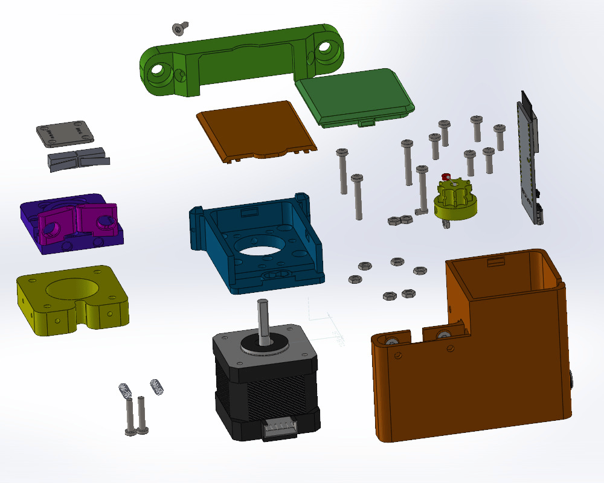

1. Printed parts from [3d-models/Controller](3d-models/Controller). White PETG is recommended. Depending on which side of the room you install the device on, you may need to mirror the `electronicBox` and `electronicBoxCover` parts.
2. A NEMA 17 motor with a body length of **34–38 mm**.
3. An **ESP32-S3 N8R2**. Solder the pin headers on the opposite side of the board, as shown below.
4. End switches like the one shown below.
5. An **AS5600 magnetic encoder module**, as shown below.
6. An **8 mm diameter power connector**.
7. A **12 V to 5 V step-down converter**.
8. A stepper driver (**TMC2208 or TMC2209 recommended**) and a PCB.
9. Springs from ballpoint pens.
10. M3 fasteners; see the [assembly instructions](3d-models/Controller/Assembly_Guide.pdf).
11. A **VS1838B** (optional).
12. **3 mm red and blue LEDs** (optional).
13. An **IRLU024N MOSFET** for an LED strip (optional).
14. An LED strip (optional).

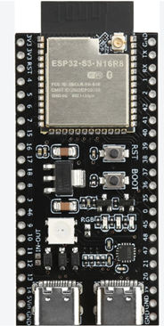

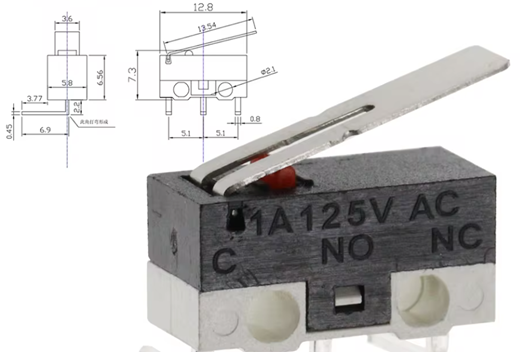

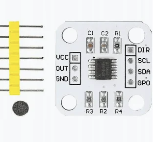

### Pulley block

1. Printed parts from [3d-models/PulleyBlock](3d-models/PulleyBlock). White PETG is recommended.
2. Two **608 bearings**.
3. An **8 mm bearing bolt**, or a standard **M8 × 30 bolt or screw**.
4. An **M8 DIN 985 nut**.
5. Four **M3 nuts**.
6. Four **M3 × 16 screws**.

### Remote (optional)

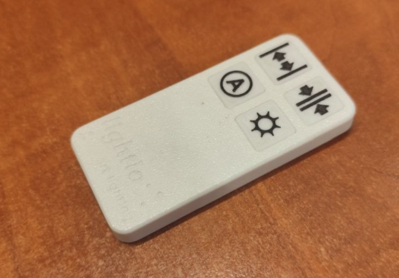

1. Printed parts from [3d-models/Remote](3d-models/Remote).
2. A **CR2032 battery**.
3. Four **6 × 6 × 5 mm buttons**.
4. A remote control IC that supports the **NEC protocol**. I use an IC from an inexpensive, unbranded remote for a color LED strip. More common ICs, such as the **SC6122**, should also work.

### Additional parts

- Printed parts from [3d-models/AdditionalDetails](3d-models/AdditionalDetails).
- Two **M3 × 8 screws**.
- Plastic ball chain. Tested with a chain with a **4.2 mm ball diameter** and **8 mm spacing between balls**.
- Nylon cord, **2–3.5 mm in diameter**.

**Note:** The pulley block is designed so that half of the loop consists of ball chain and the other half consists of nylon cord. This reduces noise because the moving balls catch against the curtain edges.

## Installation

1. Make sure the device's end switches work correctly. If necessary, adjust the metal levers on the switches. Flash the device, power it on, configure WiFi and the password, then disconnect power.

   To enable access point mode, hold the Open or Close button on the remote and reset the controller, or use the configuration pin. All LEDs blink when the controller is in access point mode.

2. Set the stepper driver's microstepping and motor current. I set the current close to the maximum. If the current is too high, the driver will enter protection mode and shut down.
3. Mark the device's position on the wall so that the curtain track is between the two planned cord runs.
4. Attach it using two screws or wall plugs. Secure the device with a small **1.5 × 5 mm screw**.

   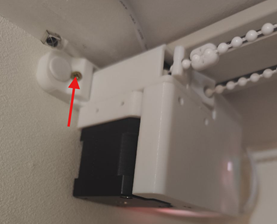

5. Mount the pulley block on the other side in the same way.
6. Measure and cut the ball chain and nylon cord.
7. Power on the device and press any Open, Close, or Home button. The device will slowly turn the motor in the opening direction.

   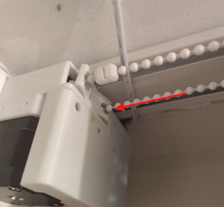

   Feed the end of the ball chain into the opening so that the device pulls it through until it comes out on the other side. Do not press the end switches during this step. Stop the device or disconnect power.

8. Join the ends of the ball chain and nylon cord using the connectors. Tension the cord and tighten the screw.
9. Attach the curtain edge to the connector. For the second curtain panel, you may need an additional printed `presser` part.
10. Open the curtain manually. Position the `presser` **1 cm from the OPEN end switch**, leaving room for the curtain to move further.

    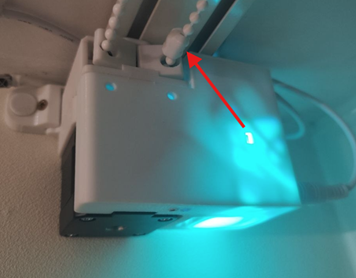

11. Close the curtain manually. Position the `presser` **1 cm from the CLOSED end switch**.

    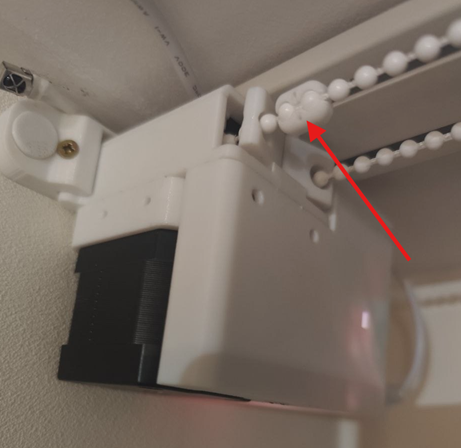

12. Home the curtain and set its maximum travel:

    1. Power on the device.
    2. Hold the **Open** button on the remote for **more than 3 seconds**, or press **Home** in the WebUI. The curtain will slowly open until it activates the end switch. This is the curtain's zero position.
    3. Press **Open** to confirm the zero position.
    4. Hold the **Close** button on the remote for **more than 3 seconds**, or press **Define max position** in the WebUI. The curtain will slowly close until it activates the end switch.
    5. Press **Close** to save the total curtain travel.

    **Note:** The home position is not retained after a restart, so an Open or Close command will first trigger homing. You can repeat homing if calibration is lost, or use **Define max position** after moving a `presser`.

13. Use the WebUI to set the desired Home Assistant IP address, NTP server, LED brightness, and other settings.

## Useful features

- You can view the device's status through the WebUI:

  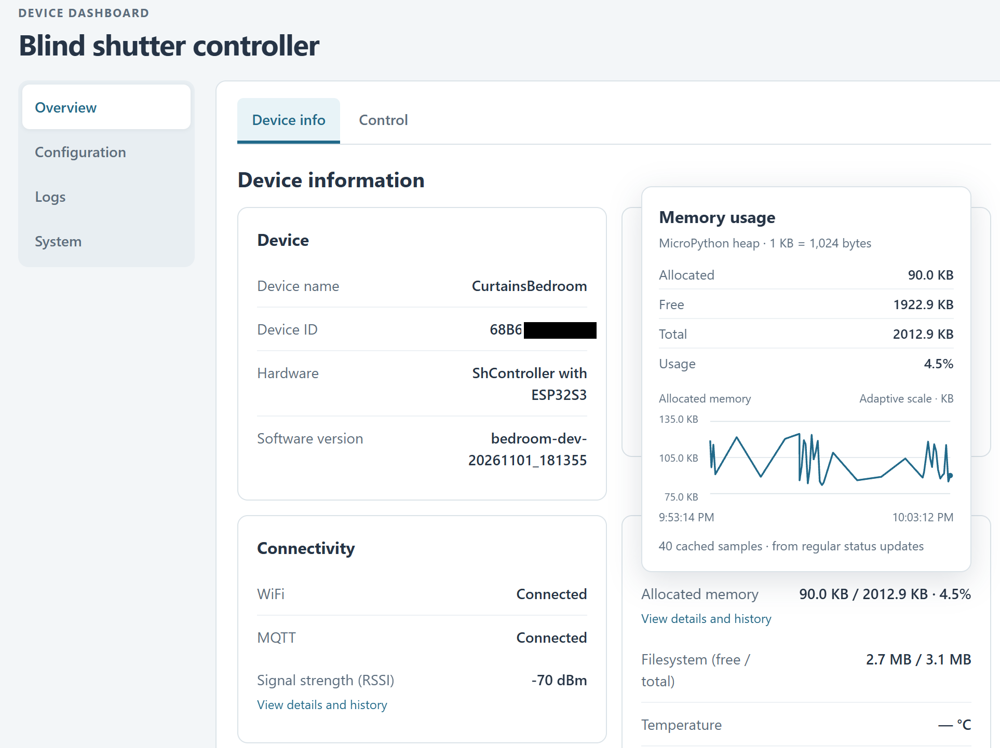

- You can also control the curtain position, movement speed, automatic mode, and lighting brightness:

  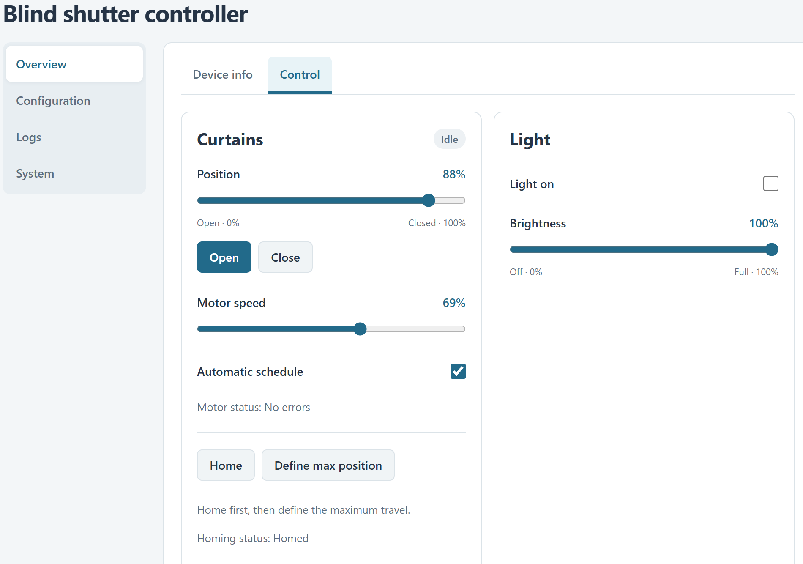

- The WebUI lets you set schedules for opening and closing the curtains and controlling the lighting:

  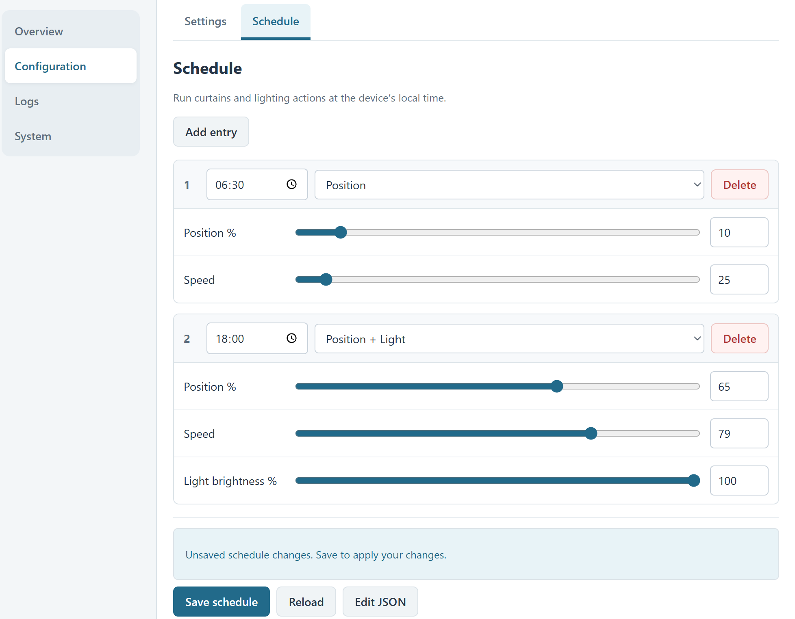

- If you have Home Assistant installed and MQTT connected, the integration will appear in Home Assistant:

  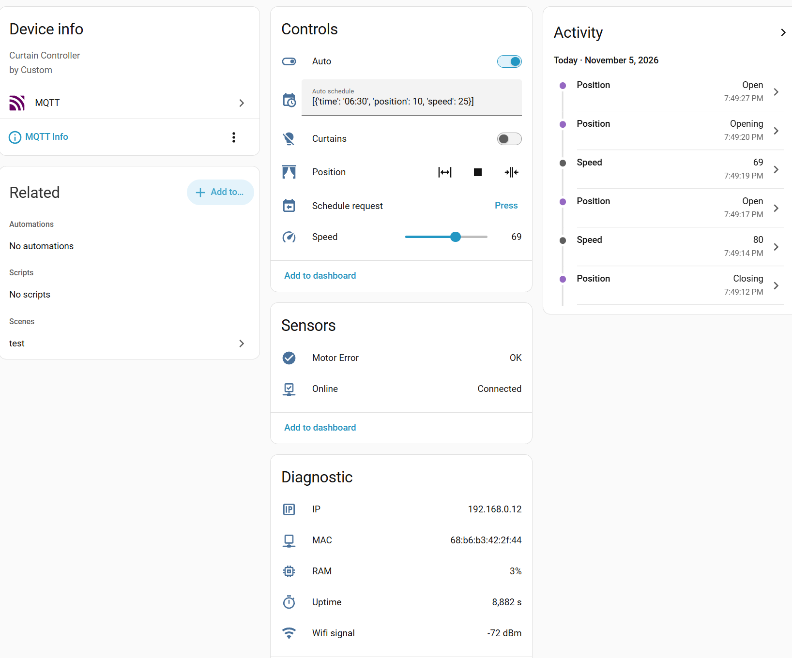

- In the IR remote settings, you can enter button codes from any remote that supports the NEC protocol. Unrecognized button codes should appear in the logs.
